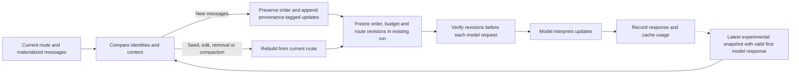

# Experimental ancestor updates in Agent Run

Agent Run accepts the optional request field `"contextStrategy": "appendParentUpdates"`.
The default orders history from root to leaf. The experimental order aims to
retain more of the prefix when the same child runs again after an ancestor
appends a message. The default can retain a longer shared prefix when
switching between siblings. The provider decides which tokens actually hit.



## Decision

- Each branch uses its latest persisted experimental snapshot whose first model
  step returned a valid turn. An enqueued snapshot records what was prepared.
  Acknowledgment comes from the existing model step record. Cancelled requests
  that reached no valid model response cannot advance the baseline.
- The assembler compares source node, message ID, role and materialized body.
  Append preserves the last model-visible order. Editing, removing or changing
  the materialized contents of an existing message resets the order. Compaction
  uses the default route order and records a rebuild. Existing messages remain
  in their original tables and full inputs stay in private run snapshots.
- Source labels preserve the original role. The model interprets business
  constraints. Tool permissions, approval and writeback remain controlled by
  the runtime. Cache misses and expiry have no effect on assembly.
- Stop supplying the optional field to stop creating experimental runs. Finish
  or cancel queued experimental runs before downgrading to a binary without
  the experimental prompt layout.

## Verify

Run the backend tests, then opt in to the paid synthetic comparison using the
existing `EVAL_BASE_URL`, `EVAL_MODEL` and `EVAL_API_KEY` settings:

```sh
python scripts/evaluate_agent.py --live --prefix-cache --output evals/prefix-cache.local.json
```

The report gives three paired trials each for same-branch continuation and
sibling switching. Both arms use the same model, static instructions and tools.
Results include reported token counts, duration, isolation and application of
the new constraint. A null delta is inconclusive. Compaction is reported
separately. Keep provider credentials and generated reports out of the PR.
